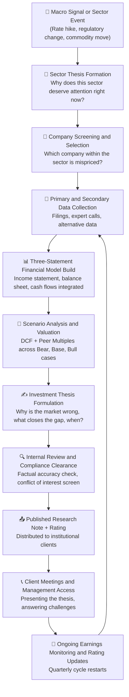
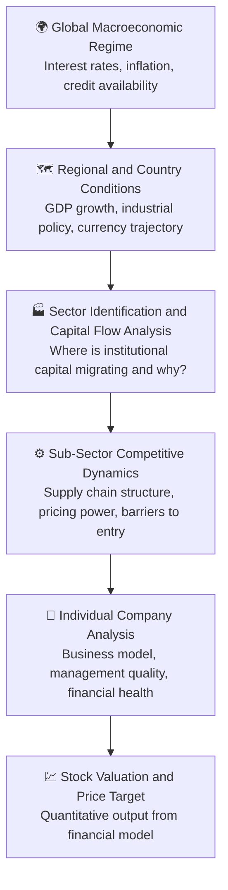
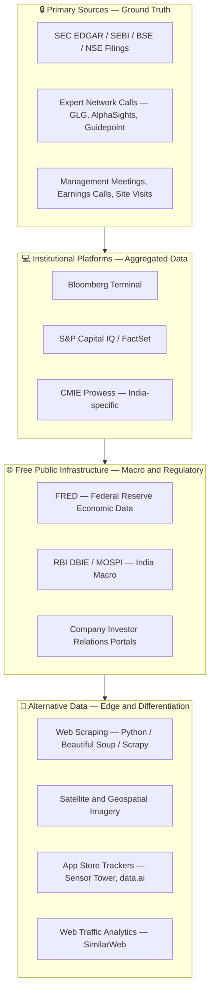
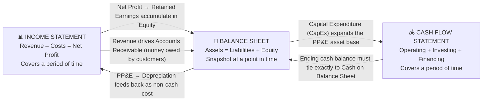
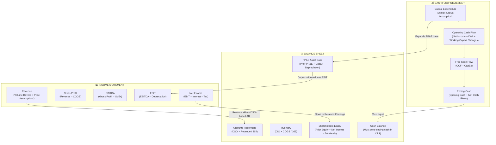
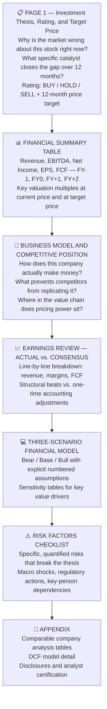

# The Equity Research Production Manual
### A Field Guide for Analysts Starting From Zero

---

> **Who this manual is for:** You have just joined an equities research desk at an investment bank. Your background is in engineering, mathematics, or the humanities — not finance. You will be expected to produce research reports within weeks. This manual builds the entire production framework from the ground up: what a stock actually is, why research exists, and how a blank spreadsheet becomes a published Buy or Sell rating that moves capital.

---

## Part I — The Foundation

### Stocks, Ownership, and the Gap Between Price and Value

A company needs capital to exist. To hire people, buy equipment, fund inventory, and expand operations. It has exactly two ways to raise that capital: borrow it (debt) or sell ownership stakes in itself (equity). When a company sells those ownership stakes to the public through a formal exchange — the New York Stock Exchange, the Bombay Stock Exchange, the London Stock Exchange — those units of ownership are called **shares**, or **stocks**.

Buy one share of Tata Consultancy Services and you own a fractional piece of TCS. The company has approximately 3.6 billion shares outstanding. Your one share represents roughly one 3.6-billionth of the entire business. Small, but real. Your legal claim on TCS's future earnings and assets is genuine.

The **stock price** is simply the last price at which a willing buyer and a willing seller agreed to exchange one share. Nothing more. That price reflects the collective forecast of every market participant about the future cash flows that ownership stake will generate. The problem: markets frequently get that forecast wrong. They overreact to news. They anchor to narratives. They are driven by fund flows, index rebalancing, and investor panic as much as by underlying business fundamentals.

This creates the central opportunity in equity research: **price and value diverge constantly.** A stock trading at ₹2,000 is not necessarily worth ₹2,000. [Benjamin Graham and David Dodd first codified this principle in *Security Analysis* (1934, McGraw-Hill)](https://www.amazon.com/Security-Analysis-Sixth-Foreword-Buffett/dp/0071592539) — the observation that the market is a voting machine in the short run and a weighing machine in the long run. Equity research exists to operate the weighing machine: to calculate what an asset is actually worth, compare it to what it trades at, and tell clients whether to buy, hold, or sell.

### What Equity Research Actually Produces

An equity research report is a formal, published document — typically 10 to 80 pages — that makes three things unambiguous:

1. **An investment thesis:** A specific, evidence-based argument for why the market is currently mispricing this stock.
2. **A 12-month target price:** A quantitative output derived from financial modeling and valuation, not guesswork.
3. **A rating:** Buy, Hold, or Sell — with no wriggle room.

That document gets distributed to institutional clients — mutual funds like HDFC AMC or Fidelity, insurance companies, pension funds, sovereign wealth funds — who use it to make allocation decisions worth crores or millions of dollars. The research desk at an investment bank generates revenue through these client relationships. Analysts are not paid to be right every single time. They are paid to be rigorous, transparent, and completely defensible every time.

---

## Part II — The Research Pipeline

### From Raw Idea to Published Rating

Before any analysis begins, understand the production sequence. Every research note — whether a 3-page earnings update or an 80-page initiation of coverage — passes through this pipeline:



Steps D through K repeat in a continuous loop throughout the life of a coverage relationship. A research franchise is not built on a single brilliant note — it is built on years of disciplined, consistent tracking.

---

## Part III — Top-Down Before Bottom-Up

### Why Macro Analysis Governs Stock Selection

The most common mistake a new analyst makes is falling in love with a company before understanding the environment that company operates in. A beautifully constructed thesis on a technology company collapses when the central bank raises interest rates 500 basis points and compresses the entire sector's valuation multiple. An operationally mediocre bank posts record profits when the yield curve steepens sharply in its favour.

The macro environment is the tide. Individual companies are boats. The tide determines the direction of travel far more than the shape of any individual hull.

Institutional research architecture therefore always runs top-down:



Only after forming a view at each level above does the analyst arrive at a stock-level conclusion with any conviction.

### Reading Macro Regimes and Deploying Capital Accordingly

Interest rate cycles, inflation trajectories, and credit conditions determine which sectors attract institutional capital and which get abandoned. The table below maps regime characteristics to allocation logic — this is sector rotation in its most practical form:

| Macro Regime | Interest Rate / Inflation Profile | Capital Flows Toward | Capital Flows Away From |
|---|---|---|---|
| **High Inflation / Rate Hiking Cycle** | Rates rising, CPI elevated | Financials (wider Net Interest Margins), Energy, Commodities | Pre-revenue Technology, long-duration growth stocks |
| **Deflationary / Low-Growth** | Rates falling or near zero, GDP contracting | Consumer Staples, Healthcare, Utilities | Cyclicals, Industrials |
| **Early-Cycle Recovery** | Rates bottoming, credit conditions loosening | Industrials, Materials, Consumer Discretionary | Defensives |
| **Late Cycle / Peak Growth** | Rates rising again, growth beginning to decelerate | Quality factors, Defensives | High-leverage, low-quality cyclicals |

The US Federal Reserve's published statements and the Reserve Bank of India's [Monetary Policy Committee communiqués](https://www.rbi.org.in/Scripts/BS_PressReleaseDisplay.aspx) are primary inputs for reading the current regime. [Ray Dalio's "How the Economic Machine Works" (Bridgewater Associates, 2013)](https://www.economicprinciples.org) provides the clearest first-principles explanation of credit cycles and their sector-level capital flow implications.

### Structural vs. Cyclical: The Distinction That Separates Alpha From Noise

Not every sector upswing is created equal. A **cyclical upswing** is temporary — driven by commodity price spikes, inventory restocking waves, or short-term credit availability. When those conditions reverse, the upswing reverses with them. A **structural shift** is permanent — driven by regulatory mandates, irreversible technology adoption curves, or long-term demographic change.

A steel company posting record profits because iron ore prices spiked is a cyclical story. An electric vehicle manufacturer systematically gaining market share because combustion engine bans are now legislated across the EU and several Indian states is a structural story. The research thesis built on these two situations has completely different durability and, therefore, different valuation implications.

**Data signatures that distinguish the two:**
- Cyclical upswings show up in commodity price curves, capacity utilization statistics, and inventory indices.
- Structural shifts show up in legislative databases, patent filing trend data, and long-run demographic series from sources like the [UN World Population Prospects](https://population.un.org/wpp/).

Allocate 70% of your coverage capacity to sectors experiencing structural inflections or deep cyclical dislocations. The stagnant middle — sectors with flat growth, uninspiring capital returns, and no catalytic events on the horizon — produces research nobody reads and positions nobody takes.

---

## Part IV — Building the Data Stack

### The Information Architecture Every Analyst Needs

Research quality has a hard ceiling imposed by data quality. A layered, verified data stack must be constructed before any analytical work begins.



### Primary Filings: The Only Source That Cannot Be Wrong By Design

Every third-party aggregator — Bloomberg, Capital IQ, news databases — is derived from primary filings. Derivation introduces transcription errors, aggregation lags, and classification inconsistencies. Go to the source directly, always.

**United States — [SEC EDGAR](https://www.sec.gov/edgar):** Every US-listed public company files here. The documents that drive research work:

- **10-K (Annual Report):** Full-year financial statements, Management Discussion and Analysis (MD&A), risk factors, and — critically — the notes to financial statements. Notes contain off-balance-sheet obligations, lease liabilities, contingent liabilities, and related-party transactions that data aggregators systematically miss or misclassify.
- **10-Q (Quarterly Report):** The 10-K compressed into a 90-day cycle. Track sequential changes in key balance sheet line items — accounts receivable, inventory levels, deferred revenue — because these often reveal business deterioration or acceleration weeks before it shows up in the income statement.
- **8-K (Material Events Disclosure):** Filed within four business days of any material corporate event — a CEO resignation, an acquisition announcement, a credit rating downgrade, a regulatory investigation. These filings move stock prices the day they are published.

**India — BSE and NSE Filing Portals:** [SEBI](https://www.sebi.gov.in) mandates quarterly earnings filings through the [BSE disclosure portal](https://www.bseindia.com) and [NSE NEAPS](https://www.nseindia.com). Indian Annual Reports additionally include Auditor's Reports and Related Party Transaction disclosures with granular detail. Read both with care — related-party transactions and auditor qualifications are where accounting irregularities surface first. The [SEBI LODR Regulations, 2015](https://www.sebi.gov.in/legal/regulations/sep-2015/sebi-listing-obligations-and-disclosure-requirements-regulations-2015_30405.html) define the full disclosure framework.

### Institutional Platforms: What Each Does and Where Each Wins

**Bloomberg Terminal** is the industry's operating system. Its primary equity research functions:

- `EE <GO>`: Pulls consensus earnings estimates from all covering analysts, broken down by quarter and fiscal year. Use this to understand precisely how your estimate diverges from consensus — that divergence is your published edge.
- `ANR <GO>`: Displays all analyst ratings on a stock, their 12-month target prices, and the Buy/Hold/Sell distribution. When 90% of covering analysts have a Buy rating on a stock, that crowding itself is information — it signals that the market has already priced in the optimism.
- `DDIS <GO>`: Institutional ownership disclosure, showing which funds are building or liquidating positions over the last reported quarter.

**[S&P Capital IQ](https://www.spglobal.com/marketintelligence/)** and **[FactSet](https://www.factset.com)** outperform Bloomberg for deep historical financial statement parsing, cross-company financial screeners, and pulling 10+ years of normalized quarterly data. Use these for model building rather than real-time market data.

**[CMIE Prowess](https://prowess.cmie.com)** is the Indian-market equivalent — deep historical financial series on Indian listed companies going back to the early 1990s, with standardized formats that make cross-company comparison tractable.

### Free Macro Stacks: Federal Reserve and RBI Infrastructure

The [Federal Reserve Economic Data (FRED) database](https://fred.stlouisfed.org) from the St. Louis Fed contains over 800,000 economic time series — interest rates, unemployment, industrial production, credit spreads, historical inflation data — all freely accessible and downloadable in structured formats. This is the primary macro data engine for US-focused research.

For India: the [RBI's DBIE portal](https://dbie.rbi.org.in) provides equivalent macro series — repo rates, credit growth data, banking sector aggregates, inflation indices. [MOSPI](https://www.mospi.gov.in) (the Ministry of Statistics) publishes GDP, IIP (Index of Industrial Production), and CPI data on fixed release schedules. Build a calendar of these release dates — data surprises relative to consensus forecasts move markets predictably.

### Expert Networks and the Primary Intelligence Edge

Before publishing a thesis on a consumer electronics retailer, speaking to two former regional operations managers at that company and three of its key component suppliers tells you things no regulatory filing ever will. Expert networks including [GLG](https://glginsights.com), [AlphaSights](https://www.alphasights.com), and [Guidepoint](https://www.guidepoint.com) connect analysts with verified former executives and industry specialists for structured, recorded consultations. Costs run approximately [INSERT CURRENT COST METRIC HERE] per hour-long call.

The legal boundary here is absolute: **material non-public information (MNPI) cannot be traded on or included in research.** If a former CFO discloses that the company missed its quarterly numbers before the official announcement, that information is MNPI. Using it constitutes insider trading. Both [SEBI's Prohibition of Insider Trading Regulations, 2015](https://www.sebi.gov.in/legal/regulations/jan-2015/sebi-prohibition-of-insider-trading-regulations-2015_26746.html) and the US [Securities Exchange Act Section 10(b)](https://www.sec.gov/divisions/enforce/insider-trading.shtml) prosecute violations aggressively, with criminal penalties in addition to civil ones. Expert calls should be conducted with compliance-approved question frameworks.

### Alternative Data: Where Research Differentiation Now Lives

The research edge from reading filings and modeling consensus numbers is narrow — hundreds of analysts read the same filings. Alternative data is where differentiation increasingly originates.

- **E-commerce pricing scrapers:** Python-based scrapers using [Beautiful Soup](https://beautiful-soup-4.readthedocs.io/) or [Scrapy](https://scrapy.org/) can track daily price movements across Flipkart, Amazon India, and Amazon US — giving a same-day read on pricing dynamics and promotional intensity weeks before the earnings call.
- **App store trackers:** [Sensor Tower](https://sensortower.com) and [data.ai (formerly App Annie)](https://www.data.ai) track daily app download rankings, revenue estimates, and engagement metrics for mobile-first businesses. A sudden acceleration in downloads weeks before the quarter closes signals a revenue beat.
- **Web traffic analytics:** [SimilarWeb](https://www.similarweb.com) tracks monthly active users and traffic trends across web properties — particularly useful for e-commerce and fintech coverage.
- **Satellite imagery:** Hedge funds now routinely use satellite images of factory parking lots, shipping yards, and retail car parks to estimate capacity utilization and foot traffic before official numbers emerge.

---

## Part V — The Diagnostic Gauntlet: Universal Financial Metrics

### Reading the Three Financial Statements as a Unified System

Every listed company publishes three core financial statements. These are not three separate documents — they are three windows into the same underlying economic reality. Miss the connections between them and your model will fail to catch problems hiding in plain sight.



**The Income Statement** records revenues earned and costs incurred over a reporting period, producing a net profit or loss. The critical issue: accounting profits are not cash. Companies can book revenue from a sale before receiving payment (creating accounts receivable). They can defer costs by capitalizing them as assets. An income statement can look healthy while the underlying business hemorrhages actual cash.

**The Balance Sheet** is a snapshot of what the company owns (assets) and what it owes (liabilities), with the residual representing what belongs to shareholders (equity). The accounting equation — Assets = Liabilities + Equity — must hold at all times. If this does not balance automatically in your financial model, your model has an error. No manual plug variable fixes a broken balance sheet; it just hides the error.

**The Cash Flow Statement** eliminates the gap between accounting profit and economic reality. It is divided into:
- *Operating Activities:* Cash actually generated by the core business — real money in, real money out.
- *Investing Activities:* Cash spent on capital expenditure (building factories, buying equipment) or received from asset disposals.
- *Financing Activities:* Cash raised from new debt or equity issuance, or returned to investors via dividends and share buybacks.

A company posting strong net income alongside deeply negative operating cash flows is almost always flagging an accounting quality problem. [Penman, S.H. (2013). *Financial Statement Analysis and Security Valuation*, 5th Ed., McGraw-Hill] argues specifically that the cash flow statement is the analyst's primary truth-telling mechanism, because cash flows are structurally harder to manipulate than accrual-based income.

### Solvency and Liquidity: The Survival Screen

Before analysing growth prospects, verify that the business can survive. These three metrics form the mandatory survival check applied across every company under coverage.

---

**Net Debt to EBITDA** = (Total Debt – Cash and Cash Equivalents) / EBITDA

*What it measures:* EBITDA (Earnings Before Interest, Taxes, Depreciation, and Amortization) approximates the operating cash generation capacity of the business before capital structure effects. Net Debt to EBITDA measures how many years of operating cash generation it would take to retire all outstanding debt. A ratio of 3.0x means the company would need three years of full EBITDA generation — with zero taxes, zero capex, zero working capital changes — to become debt-free.

*Institutional threshold:* Ratios above 3.0x trigger institutional red flags for most sectors. The exception is regulated infrastructure — utilities, toll roads, pipelines — where contracted, long-duration cash flows justify higher leverage.

---

**Interest Coverage Ratio** = EBIT / Interest Expense

*What it measures:* EBIT (Earnings Before Interest and Taxes) divided by annual interest expense on outstanding debt. A ratio of 2.5x means the company earns 2.5 times its interest obligations from operating profit. A ratio below 2.5x means the company is absorbing more than 40 paisa of every operating rupee as interest payments — structural financial stress is approaching.

---

**Cash Conversion Cycle (CCC)** = Days Inventory Outstanding + Days Sales Outstanding – Days Payable Outstanding

*What it measures:* The number of days a company's cash is tied up in operations before it returns as received cash. Shorter is better. Negative is extraordinary.

| CCC Component | What It Means | Formula |
|---|---|---|
| Days Inventory Outstanding (DIO) | How long goods sit in inventory before selling | Inventory / (COGS / 365) |
| Days Sales Outstanding (DSO) | How long it takes to collect payment after a sale | Accounts Receivable / (Revenue / 365) |
| Days Payable Outstanding (DPO) | How long the company takes to pay its own suppliers | Accounts Payable / (COGS / 365) |

Companies like Walmart and D-Mart operate with negative CCC — they collect cash from customers before they have to pay their suppliers. The business essentially self-funds its working capital through sheer scale and supplier pricing power. That is a structural competitive moat.

### Capital Efficiency: Does This Business Actually Create Value?

**Return on Invested Capital (ROIC)** = NOPAT / Invested Capital

Where:
- NOPAT = Net Operating Profit After Tax = EBIT × (1 – Tax Rate)
- Invested Capital = Total Debt + Shareholders' Equity – Excess Cash

ROIC is the single most important quality metric in equity research. [Koller, T., Goedhart, M., & Wessels, D. (2020). *Valuation: Measuring and Managing the Value of Companies*, 7th Ed., McKinsey & Wiley](https://www.wiley.com/en-gb/Valuation) demonstrate conclusively that companies which consistently earn ROIC above their Weighted Average Cost of Capital (WACC) create economic value. Companies that earn below WACC destroy it — regardless of how fast revenue grows. A business expanding at 30% annually with ROIC below WACC is getting larger and poorer simultaneously.

**WACC** is the blended required return of all capital providers — debt holders and equity holders combined:

```
WACC = (E/V × Ke) + (D/V × Kd × (1 – Tax Rate))
```

Where: E = Market value of equity, D = Market value of debt, V = E + D, Ke = Cost of equity (from CAPM: Risk-free rate + Beta × Equity Risk Premium), Kd = Pre-tax cost of debt.

**Return on Equity (ROE)** = Net Income / Shareholders' Equity

ROE is useful but manipulable. Companies inflate ROE by taking on excessive debt, which shrinks the equity denominator. Always decompose ROE using DuPont Analysis before accepting the headline number:

```
ROE = Net Profit Margin × Asset Turnover × Financial Leverage
```

High ROE driven by high margin and high asset turnover is durable. High ROE driven entirely by financial leverage is fragile and dangerous.

### Free Cash Flow: The Number That Cannot Lie for Long

**Free Cash Flow (FCF)** = Operating Cash Flow – Capital Expenditure

FCF is the cash a business generates after maintaining and expanding its asset base. It funds dividends, share buybacks, debt repayment, and acquisitions. Everything that creates shareholder value flows from sustained FCF generation.

**FCF Yield** = FCF / Enterprise Value (or Market Capitalisation)

High accounting net income matched with near-zero or negative FCF signals one of two problems: the business requires massive capital reinvestment just to hold its current revenue position (a structural capital intensity problem), or management is aggressively recognising revenue before cash materialises (an accounting quality problem). Both destroy long-term shareholder value. The income statement can hide this for quarters; the cash flow statement cannot.

---

## Part VI — Sector-Specific Valuation Mechanics

### Why Applying One Valuation Framework Breaks Everything

Using a single valuation multiple across all industries is one of the most consequential errors new analysts make. A retail bank and a SaaS company share no meaningful financial architecture. A pharmaceutical company's most valuable asset — a drug molecule in Phase III trials — does not appear on its balance sheet at all. Forcing all companies into the same valuation framework produces nonsense outputs.

The expanded sector evaluation matrix below maps major industry groups to their correct valuation architecture:

| Sector | Primary Valuation Multiple | Why This Multiple, Not P/E | Critical Non-GAAP Operating Metrics |
|---|---|---|---|
| **Technology / SaaS** | EV / Forward NTM Revenue | Revenue is the leading indicator; profitability trails by years | NRR (target >110%), LTV/CAC (target >3x), Rule of 40 |
| **Banking / Financials** | Price-to-Book (P/B), P/E | Debt is operational input — EV is meaningless for banks | NIM, CET1 Ratio (>12%), GNPA%, PCR (>70%) |
| **Energy / Oil and Gas** | EV/EBITDAX, EV/BOE | Normalises for exploration accounting method differences | RRR (>100%), Lifting Cost/barrel, GRM |
| **Healthcare / Pharma** | Risk-Adjusted NPV, SOTP | Binary pipeline outcomes demand probability weighting | Phase III pipeline count, Patent expiry calendar |
| **Retail / Consumer** | EV/EBITDA, P/E | Store economics are the operational driver | SSSG, GMV, Inventory Turnover Ratio |
| **Industrials / Capex** | EV/EBITDA, P/E | Capital cycle visibility drives multiple expansion | Order Book, Capacity Utilization, ROCE |
| **Real Estate (REITs)** | Price/FFO, Dividend Yield | Depreciation severely distorts net income | Occupancy Rate, Cap Rate, NAV per unit |

### Technology and SaaS: Revenue Growth Before Profitability — Until It Isn't

Traditional accounting fails software companies because customer acquisition costs are expensed immediately, while the resulting subscription revenue materialises over three-to-five-year contract periods. A SaaS company spending aggressively on sales and marketing will post appalling near-term P/E ratios while building enormous future recurring revenue. Penalising it on earnings multiples is structurally incorrect.

**Annual Recurring Revenue (ARR)** is the baseline quality metric. Track sequential quarter-over-quarter ARR growth, not just year-over-year, to detect inflections before they appear in annual comparisons.

**Net Revenue Retention (NRR):**

```
NRR = (Starting MRR + Expansion Revenue – Contraction – Churn) / Starting MRR
```

NRR measures what happens to revenue from existing customers alone — without counting new customer acquisitions. NRR above 110% means existing customers expand their spend faster than some leave. Institutional buyers demand this threshold for enterprise SaaS because it proves the product is both sticky and expandable within accounts. NRR below 100% means the company is running a leaking bucket — new customer acquisitions are simply replacing customers walking out the back.

**The Rule of 40** = Year-over-Year Revenue Growth Rate + EBITDA Margin

[Andreessen Horowitz formalised the Rule of 40 as a SaaS health heuristic](https://a16z.com/the-rule-of-40-for-a-healthy-saas-company/). A score above 40 confirms the company is successfully balancing growth investment with improving economics. A company growing 60% with -20% EBITDA margins scores 40 — acceptable. A company growing 10% with 15% margins scores 25 — something is broken in either the growth engine or the cost structure.

### Banking and Financial Institutions: Where Standard Ratios Collapse

**Never apply Enterprise Value to a bank.** For industrial companies, debt is a financing choice that funds the business and sits separate from operations. For a bank, debt — customer deposits, wholesale borrowings — *is* the raw material of the business. The bank borrows money at one rate and lends it out at a higher rate. Attempting to separate "operational debt" from "financing debt" in a bank's capital structure is conceptually meaningless.

Use **Price-to-Book (P/B)** instead. Book value (shareholders' equity) represents the bank's capital cushion. A P/B above 1.0x signals the market believes the bank will generate returns above its cost of equity. Below 1.0x signals the opposite — the market believes the bank will earn less than it needs to justify its capital base.

**Net Interest Margin (NIM)** = Net Interest Income / Average Earning Assets

NIM is the central operating driver of banking profitability — the spread between what the bank earns on its loan portfolio and what it pays on its liabilities. A 50-basis-point NIM compression on a bank with ₹10 lakh crore of earning assets destroys ₹5,000 crore of annual income. Track NIM trajectory across rate cycles.

**GNPA (Gross Non-Performing Assets)%** tracks the percentage of the total loan book that has stopped generating interest or principal repayments. The RBI defines an asset as NPA if it remains overdue for more than 90 days. [RBI's Master Circular on Income Recognition, Asset Classification and Provisioning](https://www.rbi.org.in/Scripts/BS_ViewMasCirculardetails.aspx?id=12256) sets the classification framework. A rising GNPA sequence — even a modest one across three consecutive quarters — signals deteriorating underwriting standards and presages future credit losses.

**Provision Coverage Ratio (PCR)** = Loan Loss Provisions / Gross NPA

A PCR above 70% means the bank has already set aside over 70% of its identified bad loans as balance sheet provisions. When those loans eventually default fully, the income statement impact is cushioned because the provisioning hit has already been absorbed. A PCR below 50% is a deferred earnings landmine.

### Energy and Commodities: Depleting Assets and Cost Curve Position

Oil, gas, and mining companies own assets that physically diminish as production occurs. This creates valuation dynamics with no equivalent in software or consumer businesses.

**Reserve Replacement Ratio (RRR)** = New Proved Reserves Added / Reserves Produced in the Period

An RRR consistently below 100% means the company is producing its reserves faster than it discovers or acquires new ones. It is, in the most literal sense, liquidating itself. [The Society of Petroleum Engineers PRMS framework](https://www.spe.org/en/industry/reserves/) defines global reserve classification and reporting standards.

**EV/EBITDAX** normalises for a structural difference in how oil companies account for exploration costs. Some expense all exploration costs immediately regardless of success ("full cost method"). Others only capitalise successful wells ("successful efforts method"). EBITDAX adds exploration costs back to EBITDA to make cross-company comparison apples-to-apples.

**Lifting Cost per Barrel** defines where a company sits on the global production cost curve. When oil prices collapse — as they did in 2014-16 and 2020 — companies with lifting costs above the prevailing market price stop generating positive operating cash flow. The [IEA's World Energy Outlook](https://www.iea.org/reports/world-energy-outlook-2024) publishes breakeven production cost data by basin globally. Know your covered company's position on that curve.

### Pharmaceuticals and Healthcare: Valuing Binary Outcomes

A pharmaceutical company's most valuable asset is frequently not on its balance sheet — it is a drug molecule in a clinical trial. That molecule either receives regulatory approval from the FDA (US) or CDSCO (India) or it does not. The outcome is binary. Standard DCF fails here because it cannot handle genuinely binary probability distributions.

**Risk-Adjusted Net Present Value (rNPV):**

```
rNPV = (Probability of Approval × Peak Annual Revenue × Patent-Protected Duration)
       – Development and Commercialisation Costs
       [All discounted at appropriate WACC]
```

Apply [historical clinical success rates published by the Biotechnology Innovation Organisation (BIO, 2016)](https://www.bio.org/):
- Phase I through to final approval: approximately 9.6%
- Phase II through to final approval: approximately 20.9%
- Phase III through to final approval: approximately 58.1%

These are not pessimistic estimates — they are historical averages. The majority of drug candidates fail.

**Patent Expiry Calendars** are existential inputs for pharma modeling. When a blockbuster drug loses patent protection, generic manufacturers typically capture 70–90% of the volume within 12 months — at 10–20% of the branded price. [IQVIA research](https://www.iqvia.com) documents typical post-patent revenue erosion curves by therapeutic area and geography. Build an explicit calendar of every patent expiry date across a company's portfolio. The revenue cliff appears on that calendar years before it hits the income statement — that advance notice is the research edge.

### Retail and Consumer Discretionary: Real Estate, Brand Equity, and Supply Chain Velocity

**Same-Store Sales Growth (SSSG)** compares sales performance of stores that have been open for at least 12 months — explicitly eliminating the revenue uplift from newly opened locations. A retailer reporting 15% total revenue growth driven by 40 new store openings while reporting -3% SSSG is expanding its physical footprint while its existing business deteriorates. That deterioration presages margin compression as the company is forced to discount to drive traffic.

**Inventory Turnover Ratio** = Cost of Goods Sold / Average Inventory

A declining inventory turnover ratio means goods are sitting on shelves longer than in prior periods. In fashion retail, this signals style obsolescence. In food retail, it creates spoilage exposure. The company will eventually mark down prices to clear inventory — destroying gross margin in the subsequent reporting quarter. The inventory buildup appears on the balance sheet quarters before the margin destruction appears on the income statement. That lag between cause and visible effect is where research edge lives.

---

## Part VII — Building the Financial Model

### Three-Statement Integration: The Architecture That Must Balance Automatically

A financial model is an explicit operating forecast. Every output number must trace back to an explicit, documented assumption. The model fails if it balances only because of a manual correction applied somewhere.



**Revenue build:** Start with volume and price assumptions, never with a single top-line growth rate. Volume drivers are company-specific — passenger kilometres flown, gigabytes of data consumed, retail square footage operated, number of active subscribers. Price drivers reflect competitive intensity and input cost pass-through capability. Building revenue from these components forces explicit reasoning about each driver and makes the model auditable and challengeable by clients.

**From Revenue to FCF:** Revenue flows through the income statement, subtracting cost of goods sold, operating expenses, and non-cash depreciation to produce EBIT. Subtract taxes to get NOPAT. Add back depreciation (non-cash), subtract working capital changes, subtract capital expenditure — the result is FCF.

### Scenario Architecture: Three Cases Are Not Optional

A single base case is a point estimate on a distribution of outcomes — it communicates almost nothing about risk. Institutional research requires explicit scenario architecture.

| Model Parameter | Bear Case | Base Case | Bull Case |
|---|---|---|---|
| Revenue Growth | GDP growth rate or below | Management guidance achieved | 150–200% of guidance |
| EBITDA Margin | Contracts 200–400 bps | Holds flat or expands 50–100 bps | Expands 200–300 bps |
| Capital Expenditure | Elevated — defensive or maintenance-heavy | Maintenance + targeted growth CapEx | Efficiency gains reduce CapEx intensity |
| Exit Multiple | 20–30% discount to sector median | At current sector median | 20–30% premium to sector median |
| Target Price Output | [INSERT SPECIFIC OUTPUT] | [INSERT SPECIFIC OUTPUT] | [INSERT SPECIFIC OUTPUT] |

The bear case is not pessimism for its own sake. It defines the precise conditions under which the investment thesis breaks, and quantifies the capital destruction that follows. If the bear case still produces an acceptable positive return, the risk/reward is asymmetric in the investor's favour — and the position deserves a larger allocation. If the bear case produces catastrophic loss of capital, position sizing must reflect that risk even if the base and bull cases are compelling.

### DCF Mechanics and Peer Multiple Valuation: The Dual-Method Target Price

**Discounted Cash Flow (DCF)** derives intrinsic value from projected future cash flows, discounted back to today at the cost of capital (WACC). The foundational logic: a rupee or dollar received today is worth more than one received in five years, because today's cash can be reinvested. [Damodaran, A. (2012). *Investment Valuation*, 3rd Ed., Wiley](http://pages.stern.nyu.edu/~adamodar/) provides the definitive reference framework for DCF construction across all asset classes and geographies.

```
DCF Enterprise Value = Σ [FCFt / (1 + WACC)^t] + Terminal Value / (1 + WACC)^n

Terminal Value = FCFn × (1 + g) / (WACC - g)
```

Where *g* = terminal growth rate, set at long-run nominal GDP growth. For India: 6–7%. For the US and developed Europe: 2–3%.

DCF is powerful but acutely sensitive to terminal value assumptions. In most corporate models, terminal value represents 60–80% of the total derived enterprise value — a half-percentage-point change in *g* or WACC produces dramatically different target prices. Always present a sensitivity table showing target price across a matrix of WACC and terminal growth rate combinations:

| | g = 4.5% | g = 5.5% | g = 6.5% | g = 7.5% |
|---|---|---|---|---|
| **WACC = 10%** | ₹[X] | ₹[X] | ₹[X] | ₹[X] |
| **WACC = 11%** | ₹[X] | ₹[X] | ₹[X] | ₹[X] |
| **WACC = 12%** | ₹[X] | ₹[X] | ₹[X] | ₹[X] |
| **WACC = 13%** | ₹[X] | ₹[X] | ₹[X] | ₹[X] |

**Relative Valuation** anchors the target price in market reality. Identify 6–10 genuinely comparable peers — businesses with similar growth profiles, capital structures, geographic exposure, and operational models. Do not value an Indian high-growth fintech using the price-to-earnings multiple of a mature US payment processor. The growth differential alone makes the comparison analytically indefensible.

Pull each peer's current trading multiples and compute the median or revenue-weighted average. Apply that multiple to the subject company's next twelve months (NTM) projected metric.

**Combining both into a target price:**

```
Target Price = (DCF Weight × DCF Value) + (Peer Multiple Weight × Peer Multiple Value)
```

A typical split is 60% DCF / 40% peer multiples, but the weighting is a judgment call. For mature, cash-generative companies in stable sectors, DCF should dominate. For early-stage, high-growth companies where near-term cash flows are speculative, peer multiples anchor valuation more reliably than DCF outputs that are largely driven by terminal value assumptions about a distant future.

---

## Part VIII — The Research Report: Structure and Delivery

### Report Architecture: Information Hierarchy for Clients Who Read Page One

Every institutional research report follows a specific information hierarchy. Clients read the first page with intensity and skim everything after. Structure accordingly.


    DCF model detail
    Disclosures and analyst certification"]
```

**The investment thesis is not a company description.** Page 1 must answer three questions with no hedging: Why is this stock mispriced right now? What specific event or data series will correct that mispricing over the next 12 months? What evidence already exists that this correction is beginning? Everything after Page 1 is the support structure for those three answers.

**Risk factors must be specific and quantified.** "Macroeconomic deterioration" is not a risk factor. "A 75-basis-point rate hike cycle that compresses the subject company's NIM by 30 basis points, reducing FY26E earnings by 18% and contracting the target P/B from 2.1x to 1.7x" is a risk factor. Specific risks tell clients exactly when to exit — when the stated condition materialises, the thesis has broken.

### The Recommendation: Making the Call Without Qualification

Rating definitions must be understood and applied precisely. Institutional clients allocate billions based on them.

| Rating | Definition | Return Requirement |
|---|---|---|
| **BUY / OVERWEIGHT** | Expected total shareholder return (price appreciation + dividend yield) exceeds the sector hurdle rate or benchmark index return by more than 15% over 12 months | >15% above hurdle rate |
| **HOLD / NEUTRAL** | Expected return within ±5% of the broader index return. Asset is fairly priced; every rupee of capital allocated here generates an opportunity cost | ±5% of index |
| **SELL / UNDERWEIGHT** | Expected return is negative, or underperforms the hurdle rate by more than 15%. Structural operational deterioration or fundamental overvaluation | >15% below hurdle rate |

The rating must match the model output. Publishing a Hold rating on a company where the base case DCF implies 40% upside is intellectually incoherent and commercially useless. Compliance teams review ratings against quantitative outputs before publication — a stated rating that materially conflicts with the model will be sent back for reconciliation. This is the system working correctly.

---

## Part IX — The Continuous Coverage Loop

Publishing an initiation note is the beginning of a coverage relationship, not its conclusion. The ongoing obligations are non-negotiable:

**Quarterly earnings reviews:** Within 24–48 hours of results publication, release an updated note comparing actual results against your model estimates line-by-line. Revise forward estimates explicitly. If the story has materially changed, revise the rating.

**Catalyst monitoring:** Track regulatory filings, management commentary, competitor moves, and sector data releases continuously. An 8-K announcing a material contract win, a SEBI enforcement action, a supply chain disruption at a key input supplier — each requires immediate assessment and, if the thesis impact is material, a note to clients within hours.

**Annual model reset:** Each year after the Annual Report is published, rebuild the three-year forward model from current actuals. Do not roll forward stale assumptions — reset from the reported base.

The research franchise at a top-tier bank accumulates over years of accurate, consistent, honest coverage. Clients return to analysts who flag problems before the market forces them to, who revise estimates before consensus catches up, and who own their mistakes transparently rather than burying them in footnotes.

That accountability is the entire foundation of the business.

---

## Quick Reference Glossary

| Term | Definition |
|---|---|
| **ARR** | Annual Recurring Revenue — predictable, contracted annual revenue base |
| **CAGR** | Compound Annual Growth Rate — the annualised growth rate over multiple years |
| **CCC** | Cash Conversion Cycle — days of cash tied up in working capital |
| **CET1** | Common Equity Tier 1 — core regulatory capital ratio for banks |
| **COGS** | Cost of Goods Sold — direct costs to produce the goods or services sold |
| **DCF** | Discounted Cash Flow — intrinsic valuation methodology |
| **EBIT** | Earnings Before Interest and Taxes |
| **EBITDA** | Earnings Before Interest, Taxes, Depreciation, and Amortisation |
| **EV** | Enterprise Value = Market Cap + Net Debt + Minority Interest + Preferred Stock |
| **FCF** | Free Cash Flow = Operating Cash Flow – Capital Expenditure |
| **GNPA** | Gross Non-Performing Assets — percentage of bad loans before provisions |
| **GRM** | Gross Refining Margin — profit per barrel for downstream oil refiners |
| **LTV/CAC** | Customer Lifetime Value divided by Customer Acquisition Cost |
| **MNPI** | Material Non-Public Information — trading on this is illegal |
| **NIM** | Net Interest Margin — core profitability spread for banks |
| **NRR** | Net Revenue Retention — revenue expansion/contraction from existing customers |
| **NOPAT** | Net Operating Profit After Tax |
| **NTM** | Next Twelve Months — forward-looking metric period |
| **PCR** | Provision Coverage Ratio — loan loss provisions as % of gross NPA |
| **P/B** | Price-to-Book — market price as multiple of book (equity) value |
| **P/E** | Price-to-Earnings — market price as multiple of earnings per share |
| **ROIC** | Return on Invested Capital — the core capital efficiency metric |
| **ROE** | Return on Equity — net income as percentage of shareholders' equity |
| **RRR** | Reserve Replacement Ratio — for energy companies |
| **SOTP** | Sum of the Parts — valuing each business segment separately |
| **SSSG** | Same-Store Sales Growth — organic comparable store sales growth |
| **WACC** | Weighted Average Cost of Capital — blended required return of all capital providers |

---

*This manual reflects standard institutional equity research methodology as practised across global investment banks. Specific financial thresholds cited (NIM ranges, CET1 floors, ROIC benchmarks, clinical trial success rates) represent general institutional practice and vary by sector, geography, market cycle, and regulatory jurisdiction. All primary data must be verified against current regulatory filings, exchange disclosures, and prevailing market conditions before inclusion in any published research. Nothing in this document constitutes investment advice.*
