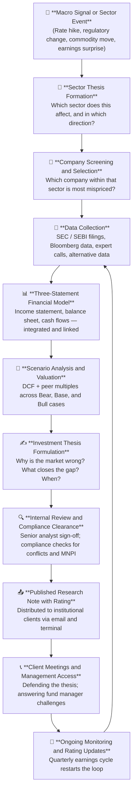
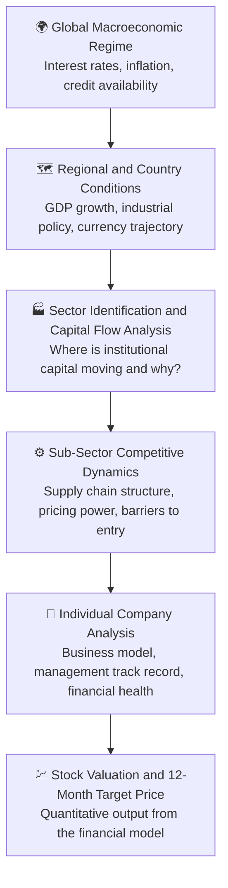
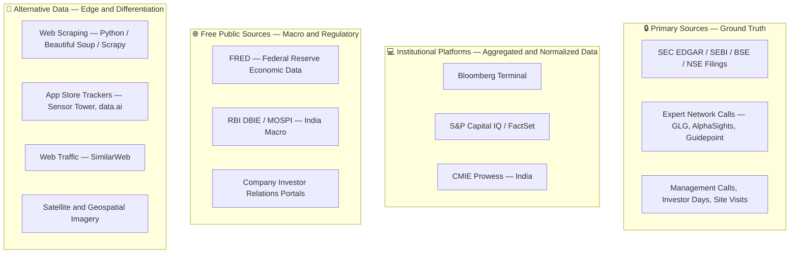
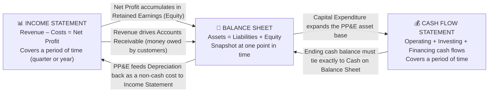
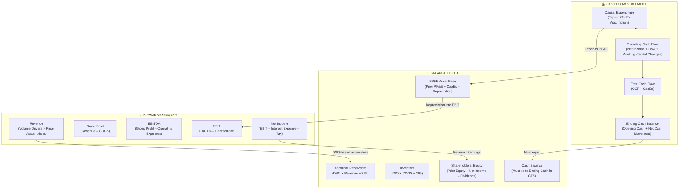
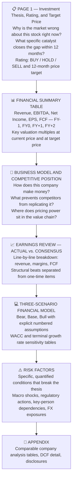

# The Equity Research Process

## Three Non-Negotiables on Every Report

The market behaves like a voting machine in the short run and a weighing machine over time. Research does the weighing. The price of a stock is the last price at which a willing buyer and seller exchanged one share. That number reflects the collective opinion of millions of market participants about what future cash flows that ownership stake will generate. The collective opinion, however, is frequently wrong. Markets overreact to bad news, underreact to structural change, and respond to fund flows and index rebalancing that have nothing to do with the underlying business.

The gap between what a stock *trades at* and what it is actually *worth* is why equity research exists. [Benjamin Graham and David Dodd codified this in *Security Analysis* (1934, McGraw-Hill)](https://www.amazon.com/Security-Analysis-Sixth-Foreword-Buffett/dp/0071592539). 

Every research report, whether 10 pages or 80, delivers exactly three things:

1. **The investment thesis:** Specific, evidence-backed argument for why the market is mispricing this stock at the moment
2. **The 12-month target price:** a number that comes out of a financial model, not instinct
3. **The rating:** Buy, Hold, or Sell, with no room for ambiguity

The reports are used by financial institutions (FIs) e.g., mutual funds like HDFC AMC or Fidelity, insurance companies, pension funds, sovereign wealth funds. Such FIs make allocation decisions worth millions of dollars based on them. The analyst reports are not expected to be right on every call but to be rigorous, transparent, and defensible on every call.

---

## From Signal to Publication: The Production Sequence

Before getting into any analytical technique, understand exactly what happens between the moment an analyst identifies a potential story and the moment a report lands in a client's inbox. Every research note passes through this pipeline:



**What actually happens at each step:**

At **Macro Signal**, the analyst reads a central bank statement, sees a commodity price move, or notices a regulatory announcement. The immediate question is not "which stock do I buy?" but "which sector does this help or hurt, and why?"

At **Sector Thesis Formation**, the analyst builds a directional view on the sector. This is a written or verbal argument — not yet a recommendation on any specific stock — that explains where capital should flow given the macro development.

At **Company Screening**, the analyst uses Bloomberg screeners or Capital IQ filters to identify which companies within the targeted sector are most likely mispriced relative to the thesis. Screens typically filter on valuation multiples, revenue growth trajectory, balance sheet quality, and short-term earnings estimate dispersion.

At **Data Collection**, the analyst reads the primary filings (10-K, 10-Q in the US; Annual Reports and quarterly filings in India), runs expert network calls to verify operational realities, and pulls historical financial data. This stage takes days to weeks for a new initiation and hours for an earnings update.

At **Model Build**, the analyst builds a three-statement integrated financial model (income statement, balance sheet, cash flow statement) that forecasts revenue, margins, cash generation, and capital structure over three to five years. This model is the quantitative foundation for everything that follows.

At **Scenario Analysis**, the analyst stress-tests the model across three explicit cases — bear, base, and bull — and derives a target price from a combination of DCF and peer multiple analysis.

At **Thesis Formulation**, the analyst writes the core argument: what the market is missing, what catalyst will close the gap, and when. This goes on Page 1 of the report.

At **Internal Review**, a senior analyst challenges every assumption. The compliance team screens for conflicts of interest and verifies that no material non-public information has entered the analysis. Reports with ratings that conflict with model outputs come back for reconciliation — as they should.

At **Publication**, the report is distributed via email and research terminal (Bloomberg, Refinitiv). For covered stocks, this happens on a fixed cycle after earnings. For new initiations, timing is strategic.

At **Ongoing Monitoring**, the analyst tracks whether the thesis is playing out, updates the model after each quarterly earnings release, and publishes updated notes whenever something material changes. A coverage relationship runs for years.

---

## Macro Environment Before the Company

Interest rate changes, inflation trajectories, and credit availability determine the performance environment for entire sectors, and that environment matters more than individual company execution during large-scale economic shifts. An analyst must form a view on the macro environment first, identify which sectors benefit or suffer, and only then select a company within the favoured sector. This is called top-down research.

New analysts make the mistake of jumping straight to a company. They build a model, fall in love with the numbers, and wonder why the stock sells off despite a solid business performance.



The analyst only arrives at a stock-level conclusion after forming a view at each level above it. Skipping the upper levels produces investment theses that are right about the company and wrong about the context, which still loses money.

### Macro Regimes and Sector Capital Flows

Different macroeconomic environments reward different sectors. The table below maps regime characteristics to sector allocation logic — this is the operational version of what practitioners call "sector rotation":

| Macro Regime | Interest Rate / Inflation Profile | Capital Flows Toward | Capital Flows Away From |
|---|---|---|---|
| **High Inflation / Rate Hiking Cycle** | Rates rising, CPI elevated | Financials (banks widen lending spreads), Energy, Commodities | Pre-revenue Technology, long-duration growth stocks |
| **Deflationary / Low-Growth** | Rates falling or near zero, GDP contracting | Consumer Staples, Healthcare, Utilities | Cyclicals, Industrials |
| **Early-Cycle Recovery** | Rates bottoming, credit conditions loosening | Industrials, Materials, Consumer Discretionary | Defensives |
| **Late Cycle / Peak Growth** | Rates rising again, growth beginning to decelerate | Quality companies with pricing power, Defensives | High-leverage, low-quality cyclicals |

The US Federal Reserve's published statements and the Reserve Bank of India's [Monetary Policy Committee communiqués](https://www.rbi.org.in/Scripts/BS_PressReleaseDisplay.aspx) are the primary inputs for identifying the current regime. [Ray Dalio's "How the Economic Machine Works" (Bridgewater Associates, 2013)](https://www.economicprinciples.org) is the clearest first-principles explanation of how credit cycles drive sector-level capital flows.

### Structural vs. Cyclical: The Distinction That Changes the Thesis Duration

A **cyclical upswing** is temporary, driven by commodity prices e.g., inventory restocking, short-term credit conditions etc. When those conditions reverse, the upswing ends with them. A steel company posting record profits because iron ore prices have spiked is a cyclical story. 

A **structural shift** is permanent, driven by regulation e.g., technology adoption,  demographic change that cannot be reversed etc. An electric vehicle manufacturer gaining market share because combustion engine bans are now legislated across multiple jurisdictions is a structural story. 

These two situations produce completely different thesis durations, different valuation multiples, and different position sizing decisions.

The data signatures are distinct: cyclical upswings appear in commodity price indices and capacity utilization statistics. Structural shifts appear in legislative text, patent filing trends, and long-run demographic data from sources like the [UN World Population Prospects](https://population.un.org/wpp/).

70% of coverage capacity should be allocated to sectors experiencing structural inflections or deep cyclical dislocations. The remaining 30% can be allocated to companies with idiosyncratic stories that are mispriced for reasons unrelated to the macro environment.

---

## The Data Stack: Where Information Comes From

Research quality has a hard ceiling set by data quality. Build the following layered stack before any analytical work begins:



### Primary Filings: The Starting Point, Not a Shortcut

Every third-party aggregator — Bloomberg, Capital IQ, news databases — derives its data from primary filings. Derivation introduces transcription errors, aggregation lags, and classification inconsistencies. Go to the source.

**United States — [SEC EDGAR](https://www.sec.gov/edgar):** Three documents drive research work:

- **10-K (Annual Report):** Full-year financials, Management Discussion and Analysis (MD&A), risk factors, and the notes to financial statements. Notes are where the real information lives — off-balance-sheet obligations, lease liabilities, contingent liabilities, related-party transactions. Aggregators systematically miss or misclassify these.
- **10-Q (Quarterly Report):** The 10-K on a 90-day cycle. The value is in sequential tracking — changes in accounts receivable, inventory, and deferred revenue across quarters reveal business acceleration or deterioration before they appear in headline numbers.
- **8-K (Material Event Disclosure):** Filed within four business days of any material corporate event — CEO departure, acquisition, credit rating change, regulatory investigation. These move prices the day they are published.

**India — BSE and NSE Filing Portals:** [SEBI](https://www.sebi.gov.in) mandates quarterly filings through the [BSE disclosure portal](https://www.bseindia.com) and [NSE NEAPS](https://www.nseindia.com). Indian Annual Reports include Auditor's Reports and Related Party Transaction disclosures. Read auditor qualifications and related-party transactions before anything else — accounting irregularities surface here first. The [SEBI LODR Regulations, 2015](https://www.sebi.gov.in/legal/regulations/sep-2015/sebi-listing-obligations-and-disclosure-requirements-regulations-2015_30405.html) define the full disclosure framework.

### Bloomberg, Capital IQ, and CMIE: When to Use Each

**Bloomberg Terminal** is the market data operating system. Its equity research functions that matter most:

- `EE <GO>` — Consensus earnings estimates from all covering analysts, by quarter and fiscal year. The divergence between your estimate and consensus is the published research edge. Know exactly where you differ and why.
- `ANR <GO>` — All analyst ratings on a stock, with target prices and the Buy/Hold/Sell distribution. When 90% of analysts carry a Buy rating, that crowding is itself information about how much optimism is already priced in.
- `DDIS <GO>` — Institutional ownership by fund, updated quarterly. Shows which funds are building or cutting positions.

**[S&P Capital IQ](https://www.spglobal.com/marketintelligence/)** and **[FactSet](https://www.factset.com)** are better than Bloomberg for deep historical financial statement parsing and cross-company financial screeners. Use these for model building. Bloomberg for real-time market data.

**[CMIE Prowess](https://prowess.cmie.com)** is the India-specific equivalent — normalized historical financial data on Indian listed companies going back to the early 1990s. Essential for any Indian coverage universe.

### Expert Networks and the MNPI Boundary

Speaking to two former regional operations managers at a retailer and three of its key suppliers will tell you things no filing ever will. Expert networks including [GLG](https://glginsights.com), [AlphaSights](https://www.alphasights.com), and [Guidepoint](https://www.guidepoint.com) connect analysts with verified former executives and industry specialists for structured, recorded consultations. Costs run approximately [INSERT CURRENT COST METRIC HERE] per hour-long call.

The legal boundary is absolute: **material non-public information (MNPI) cannot be traded on or included in research.** If a former CFO discloses that the company missed its quarterly numbers before the official announcement, using that information constitutes insider trading. Both [SEBI's Prohibition of Insider Trading Regulations, 2015](https://www.sebi.gov.in/legal/regulations/jan-2015/sebi-prohibition-of-insider-trading-regulations-2015_26746.html) and the US [Securities Exchange Act Section 10(b)](https://www.sec.gov/divisions/enforce/insider-trading.shtml) apply criminal penalties. Run all expert call questions through a compliance-approved framework before the call.

### Alternative Data: Where Research Differentiation Now Lives

Reading the same 10-K and modeling consensus numbers produces research indistinguishable from the 15 other analysts covering the same stock. Alternative data is where differentiation originates:

- **E-commerce pricing scrapers:** Python-based scrapers using [Beautiful Soup](https://beautiful-soup-4.readthedocs.io/) or [Scrapy](https://scrapy.org/) track daily price movements across Flipkart, Amazon India, and Amazon US — giving a real-time read on promotional intensity and pricing power weeks before the earnings call.
- **App store trackers:** [Sensor Tower](https://sensortower.com) and [data.ai](https://www.data.ai) track daily app download rankings, revenue estimates, and engagement metrics for mobile-first businesses.
- **Web traffic analytics:** [SimilarWeb](https://www.similarweb.com) tracks monthly active users and traffic trends — particularly useful for e-commerce and fintech.
- **Satellite imagery:** Factory parking lot density, shipping yard activity, and retail car park occupancy measured via satellite are now standard inputs at top hedge funds — these proxy capacity utilization and foot traffic before official data appears.

The [FRED database](https://fred.stlouisfed.org) from the St. Louis Fed contains over 800,000 economic time series for US macro data, all free and downloadable. For India: [RBI DBIE](https://dbie.rbi.org.in) and [MOSPI](https://www.mospi.gov.in) provide equivalent macro series — repo rates, credit growth, IIP, CPI — on fixed release schedules. Build a calendar of those release dates. Data surprises relative to consensus move markets predictably.

---

## The Core Financial Diagnostic

Every company under coverage runs through the same financial diagnostic before any sector-specific analysis begins. This diagnostic starts with the three financial statements — not as three separate documents, but as a single, linked system.



**The Income Statement** records revenues earned and costs incurred over a reporting period. Accounting profits are not cash. A company can book revenue from a sale before receiving payment, creating accounts receivable on the balance sheet. It can defer costs by capitalising them as assets. The income statement can look strong while the business is consuming cash rapidly.

**The Balance Sheet** shows what the company owns (assets) and what it owes (liabilities), with the residual belonging to shareholders (equity). The accounting equation — Assets = Liabilities + Equity — holds at all times. If a financial model does not balance automatically without a manual adjustment, the model contains an error.

**The Cash Flow Statement** eliminates the gap between accounting profit and economic reality. It has three sections: Operating (cash from the core business), Investing (cash spent on equipment and assets, or received from asset sales), and Financing (cash raised from or returned to debt and equity holders). A company posting strong net income alongside deeply negative operating cash flows has an accounting quality problem. [Penman, S.H. (2013). *Financial Statement Analysis and Security Valuation*, 5th Ed., McGraw-Hill](https://www.mheducation.com/highered/product/financial-statement-analysis-security-valuation-penman/M9780078025310.html) argues the cash flow statement is the analyst's primary truth-telling tool, because cash flows are structurally harder to manipulate than accrual-based income figures.

### Solvency and Liquidity: The Survival Screen

Before assessing growth prospects, verify the company can survive. These three metrics are the mandatory survival check applied to every covered company:

---

**Net Debt to EBITDA** = (Total Debt – Cash) / EBITDA

EBITDA (Earnings Before Interest, Taxes, Depreciation, and Amortization) approximates operating cash generation capacity before capital structure effects. The ratio measures how many years of operating cash generation it would take to retire all outstanding net debt. A ratio of 3.0x means three years of full EBITDA — with zero taxes, zero capex, zero working capital requirements — to reach a debt-free balance sheet.

Institutional red flags trigger above 3.0x for most sectors. Regulated infrastructure — utilities, toll roads, pipelines — justifies higher leverage because contracted, long-duration cash flows are predictable enough to support it.

---

**Interest Coverage Ratio** = EBIT / Interest Expense

EBIT (Earnings Before Interest and Taxes) divided by annual interest payments. A ratio of 2.5x means the company earns 2.5 times its interest obligations from operating profit. Below 2.5x, the company is absorbing more than 40 paise (or cents) of every operating rupee as interest. Financial stress is approaching.

---

**Cash Conversion Cycle (CCC)** = Days Inventory Outstanding + Days Sales Outstanding – Days Payable Outstanding

| Component | Measures | Formula |
|---|---|---|
| Days Inventory Outstanding (DIO) | How long goods sit before selling | Inventory ÷ (COGS ÷ 365) |
| Days Sales Outstanding (DSO) | How long it takes to collect after a sale | Accounts Receivable ÷ (Revenue ÷ 365) |
| Days Payable Outstanding (DPO) | How long the company takes to pay suppliers | Accounts Payable ÷ (COGS ÷ 365) |

A negative CCC — where the company collects cash from customers before paying suppliers — is a structural competitive advantage. D-Mart and Walmart both operate this way. The business self-funds its working capital requirements through scale and supplier pricing power.

---

### ROIC, WACC, and Why Growth Without Returns Destroys Value

**Return on Invested Capital (ROIC)** = NOPAT / Invested Capital

Where NOPAT = Net Operating Profit After Tax = EBIT × (1 – Tax Rate), and Invested Capital = Total Debt + Shareholders' Equity – Excess Cash.

ROIC is the single most important quality metric in equity research. [Koller, T., Goedhart, M., & Wessels, D. (2020). *Valuation: Measuring and Managing the Value of Companies*, 7th Ed., McKinsey & Wiley](https://www.wiley.com/en-gb/Valuation) demonstrate that companies which consistently earn ROIC above their Weighted Average Cost of Capital (WACC) create economic value. Companies that earn below WACC destroy it — regardless of how fast they grow. A business expanding revenue at 30% annually with ROIC below WACC is getting larger and poorer simultaneously.

**WACC** is the blended required return of all capital providers — debt and equity holders combined:

```
WACC = (E/V × Ke) + (D/V × Kd × (1 – Tax Rate))
```

Where: E = market value of equity, D = market value of debt, V = E + D, Ke = cost of equity (Risk-free rate + Beta × Equity Risk Premium from CAPM), Kd = pre-tax cost of debt.

**Return on Equity (ROE)** = Net Income / Shareholders' Equity

ROE is manipulable. Companies inflate it by taking on excessive debt, which shrinks the equity denominator. Always decompose ROE using DuPont Analysis:

```
ROE = Net Profit Margin × Asset Turnover × Financial Leverage
```

High ROE driven by margin and asset efficiency is durable. High ROE driven entirely by leverage is fragile.

### Free Cash Flow: The Number That Cannot Be Fabricated Indefinitely

**Free Cash Flow (FCF)** = Operating Cash Flow – Capital Expenditure

FCF is the cash the business generates after maintaining and expanding its asset base. It funds dividends, share buybacks, debt repayment, and acquisitions. Every form of shareholder value creation requires sustained FCF.

**FCF Yield** = FCF / Enterprise Value (or Market Capitalisation)

High net income with near-zero or negative FCF signals either structural capital intensity (the business consumes capital just to hold its position) or aggressive revenue recognition (the cash hasn't arrived yet but the income has been booked). Both eventually destroy shareholder value. The income statement can conceal this for several quarters. The cash flow statement cannot do so indefinitely.

---

## Sector Valuation: Why One Framework Fails Everything

Using a single valuation multiple across all industries is one of the most consequential errors new analysts make. A retail bank and a SaaS company share no meaningful financial architecture. A pharmaceutical company's most valuable asset — a drug molecule in Phase III trials — does not appear on the balance sheet at all. Forcing all companies into the same valuation framework produces outputs that are precisely wrong rather than approximately right.

| Sector | Primary Valuation Multiple | Why This Multiple, Not P/E | Critical Non-GAAP Metrics |
|---|---|---|---|
| **Technology / SaaS** | EV / Forward NTM Revenue | Revenue is the leading indicator; profitability lags by years | NRR (>110%), LTV/CAC (>3x), Rule of 40 |
| **Banking / Financials** | Price-to-Book (P/B), P/E | Debt is operational input — Enterprise Value is meaningless for banks | NIM, CET1 (>12%), GNPA%, PCR (>70%) |
| **Energy / Oil and Gas** | EV/EBITDAX, EV/BOE | Normalises for exploration accounting method differences | RRR (>100%), Lifting Cost per barrel, GRM |
| **Healthcare / Pharma** | Risk-Adjusted NPV, SOTP | Binary pipeline outcomes require probability weighting | Phase III count, Patent expiry calendar |
| **Retail / Consumer** | EV/EBITDA, P/E | Store economics are the operational driver | SSSG, GMV, Inventory Turnover Ratio |
| **Industrials / Capex** | EV/EBITDA, P/E | Capital cycle visibility drives multiple | Order Book, Capacity Utilization, ROCE |
| **Real Estate (REITs)** | Price/FFO, Dividend Yield | Depreciation distorts net income; FFO is the cash proxy | Occupancy Rate, Cap Rate, NAV per unit |

### SaaS and Technology: Revenue Before Profitability, Until It Isn't

Traditional accounting fails software companies. Customer acquisition costs are expensed immediately, while the resulting subscription revenue materialises over three-to-five-year contract periods. A SaaS company spending heavily on sales and marketing posts terrible near-term earnings while building a large recurring revenue base. Penalising it on a P/E multiple is analytically incorrect — the earnings metric is distorted by design.

**Annual Recurring Revenue (ARR)** is the baseline quality metric. Track sequential quarter-on-quarter ARR growth — not just year-on-year — to detect inflections early.

**Net Revenue Retention (NRR):**

```
NRR = (Starting MRR + Expansion Revenue – Contraction – Churn) / Starting MRR
```

NRR measures what happens to revenue from existing customers alone, without counting new acquisitions. Above 110% means existing customers expand their spend faster than some leave — the product is sticky and grows within accounts. Below 100% means new customer acquisitions are replacing customers leaving. The business is running in place.

**The Rule of 40** = Year-on-Year Revenue Growth Rate + EBITDA Margin

[Andreessen Horowitz formalised the Rule of 40 as a SaaS health benchmark](https://a16z.com/the-rule-of-40-for-a-healthy-saas-company/). A score above 40 confirms the company is balancing growth investment with improving economics. A company growing 60% with -20% EBITDA margins scores 40 — acceptable. A company growing 10% with 15% margins scores 25 — the growth engine or cost structure has a problem.

### Banking and Financials: Where Standard Ratios Break

Never apply Enterprise Value to a bank. For industrial companies, debt is a financing choice that funds operations. For a bank, debt — customer deposits and wholesale borrowings — *is* the raw material. The bank borrows at one rate and lends at a higher rate. Separating "operational debt" from "financing debt" in a bank's capital structure has no meaning.

Use **Price-to-Book (P/B)** instead. Book value represents the bank's capital cushion. P/B above 1.0x signals the market believes the bank will earn returns above its cost of equity. Below 1.0x signals the opposite.

**Net Interest Margin (NIM)** = Net Interest Income / Average Earning Assets

NIM is the core profitability driver — the spread between the bank's lending rate and its cost of funds. A 50-basis-point NIM compression on a bank with ₹10 lakh crore of earning assets destroys ₹5,000 crore of annual income. Every rate cycle, track NIM trajectory first.

**GNPA%** — Gross Non-Performing Assets as a percentage of the total loan book — tracks loans that have stopped generating interest or principal repayments. The RBI classifies assets as NPA if overdue for more than 90 days. [RBI's Master Circular on Income Recognition, Asset Classification and Provisioning](https://www.rbi.org.in/Scripts/BS_ViewMasCirculardetails.aspx?id=12256) sets the framework. A rising GNPA sequence across three consecutive quarters signals deteriorating underwriting and presages credit losses that will hit the income statement in coming periods.

**Provision Coverage Ratio (PCR)** = Loan Loss Provisions / Gross NPA

Above 70% means the bank has already absorbed more than 70% of its bad loans as balance sheet provisions. When those loans default fully, the income statement is cushioned. Below 50% is a deferred earnings problem.

### Energy and Commodities: Assets That Deplete

Oil, gas, and mining companies own assets that physically diminish with production. This creates valuation dynamics with no equivalent in software or consumer businesses.

**Reserve Replacement Ratio (RRR)** = New Proved Reserves Added / Reserves Produced

Below 100% consistently means the company is producing reserves faster than it is finding or acquiring new ones. [The Society of Petroleum Engineers PRMS framework](https://www.spe.org/en/industry/reserves/) sets global reserve classification standards.

**EV/EBITDAX** normalises for exploration accounting differences. Some companies expense all exploration costs immediately ("full cost method"). Others capitalise only successful wells ("successful efforts method"). EBITDAX adds exploration costs back to EBITDA, making cross-company comparison valid.

**Lifting Cost per Barrel** defines where a company sits on the global cost curve. When oil prices fall, companies whose lifting cost exceeds the market price stop generating positive cash flow. The [IEA World Energy Outlook](https://www.iea.org/reports/world-energy-outlook-2024) publishes breakeven cost data by basin. Know which basin your covered company operates in and where it sits on that curve.

### Pharma and Healthcare: Probability-Weighted Binary Outcomes

A pharmaceutical company's most valuable asset is frequently not on the balance sheet — it is a drug molecule in a clinical trial. That molecule either gets regulatory approval from the FDA (US) or CDSCO (India) or it does not. Standard DCF fails here because it cannot handle binary probability distributions.

**Risk-Adjusted Net Present Value (rNPV):**

```
rNPV = (Probability of Approval × Peak Annual Revenue × Patent-Protected Duration)
       – Development and Commercialisation Costs
       [All discounted at WACC]
```

Apply [historical clinical success rates from the Biotechnology Innovation Organisation (BIO, 2016)](https://www.bio.org/):
- Phase I through to final approval: ~9.6%
- Phase II through to final approval: ~20.9%
- Phase III through to final approval: ~58.1%

**Patent Expiry Calendars** are existential inputs for pharma modeling. Generic manufacturers typically capture 70–90% of volume within 12 months of a patent expiry — at 10–20% of the branded price. [IQVIA research](https://www.iqvia.com) documents post-patent revenue erosion curves by therapeutic area. Build an explicit calendar for every patent expiry in the portfolio. The cliff appears on the calendar years before it hits the income statement — the advance warning is the edge.

### Retail and Consumer: Same-Store Sales and Inventory Velocity

**Same-Store Sales Growth (SSSG)** compares sales from stores open for at least 12 months, explicitly removing the revenue boost from new openings. A retailer reporting 15% total revenue growth driven by 40 new stores while showing -3% SSSG is expanding its footprint while its existing business deteriorates. That deterioration will produce margin compression as the company discounts to drive traffic.

**Inventory Turnover Ratio** = Cost of Goods Sold / Average Inventory

A declining ratio means goods sit on shelves longer. In fashion, this signals style obsolescence. In food, it creates spoilage risk. The company will mark down prices to clear stock — destroying gross margin in the subsequent quarter. The inventory buildup appears on the balance sheet quarters before the margin destruction appears on the income statement. That lag between cause and visible effect is where the research edge lives.

---

## Building the Three-Statement Financial Model

A financial model is a forward operating forecast. Every output must trace to an explicit, documented assumption. The model fails if it balances only because of a manual plug somewhere.



**Build revenue from components, not from a single growth rate.** Volume drivers are company-specific — passenger kilometres flown, gigabytes of data consumed, retail square footage operated, number of active subscribers. Price drivers reflect competitive intensity and input cost pass-through capability. Disaggregating forces explicit reasoning and makes the model auditable and challengeable by clients in meetings.

**The path from Revenue to FCF:** Revenue flows through the income statement — subtract COGS to get Gross Profit, subtract operating expenses to get EBITDA, subtract depreciation to get EBIT, subtract interest and taxes to get Net Income. For FCF: start with Net Income, add back depreciation (non-cash), adjust for working capital changes (accounts receivable, inventory, payables), subtract capital expenditure.

### Scenario Architecture: Three Cases are Mandatory

A single base case communicates almost nothing about risk. Institutional research requires explicit scenario architecture:

| Parameter | Bear Case | Base Case | Bull Case |
|---|---|---|---|
| Revenue Growth | GDP rate or below | Management guidance achieved | 150–200% of guidance |
| EBITDA Margin | Contracts 200–400 bps | Holds flat or expands 50–100 bps | Expands 200–300 bps |
| Capital Expenditure | Elevated — defensive or maintenance-heavy | Maintenance + targeted growth CapEx | Efficiency gains reduce CapEx intensity |
| Exit Multiple | 20–30% discount to sector median | At current sector median | 20–30% premium to sector median |
| Resulting Target Price | [INSERT] | [INSERT] | [INSERT] |

The bear case defines the exact conditions under which the thesis breaks and quantifies the capital destruction that follows. If the bear case still produces an acceptable positive return, the risk/reward is asymmetric in the investor's favour. If the bear case produces severe capital loss, position sizing must reflect that exposure regardless of how compelling the base and bull cases appear.

### DCF and Peer Multiple Valuation: The Two-Method Target Price

**Discounted Cash Flow (DCF)** derives intrinsic value from projected future cash flows discounted back to today at the cost of capital. The logic: a rupee received today is worth more than one received in five years because today's cash can be reinvested. [Damodaran, A. (2012). *Investment Valuation*, 3rd Ed., Wiley](http://pages.stern.nyu.edu/~adamodar/) provides the reference framework for DCF construction across all asset classes and geographies.

```
DCF Enterprise Value = Σ [FCFt / (1 + WACC)^t] + Terminal Value / (1 + WACC)^n

Terminal Value = FCFn × (1 + g) / (WACC - g)
```

Where *g* = terminal growth rate. For India: 6–7%. For US and developed Europe: 2–3%.

Terminal value typically represents 60–80% of the total DCF output. A half-percentage-point change in either *g* or WACC produces a dramatically different target price. Always present a WACC / terminal growth rate sensitivity table alongside the base case:

| | **g = 4.5%** | **g = 5.5%** | **g = 6.5%** | **g = 7.5%** |
|---|---|---|---|---|
| **WACC = 10%** | ₹[X] | ₹[X] | ₹[X] | ₹[X] |
| **WACC = 11%** | ₹[X] | ₹[X] | ₹[X] | ₹[X] |
| **WACC = 12%** | ₹[X] | ₹[X] | ₹[X] | ₹[X] |
| **WACC = 13%** | ₹[X] | ₹[X] | ₹[X] | ₹[X] |

**Relative Valuation** anchors the target price in current market reality. Identify 6–10 genuinely comparable peers — similar growth profiles, capital structures, geographic exposure, and operational models. Do not value an Indian high-growth fintech using the P/E multiple of a mature US payment processor; the growth rate differential alone makes the comparison indefensible. Pull each peer's current trading multiples, compute the median or revenue-weighted average, and apply that multiple to the subject company's next twelve months (NTM) projected metric.

**The combined target price:**

```
Target Price = (60% × DCF Value) + (40% × Peer Multiple Value)
```

The 60/40 split is a judgment call, not a formula. For mature, cash-generative companies in stable sectors, DCF should carry more weight. For early-stage, high-growth companies where near-term cash flows are speculative and the terminal value assumption drives almost all of the DCF output, peer multiples anchor valuation more reliably.

---

## Report Structure and the Rating

### What Goes Where: The Information Hierarchy

Clients read Page 1 with attention and skim everything after. Structure accordingly:



**Page 1 is not a company description.** It answers three questions without hedging: Why is this stock mispriced right now? What specific event or data development closes that mispricing over the next 12 months? What evidence already exists that the repricing process has begun?

**Risk factors must be specific and quantified.** "Macroeconomic deterioration" is not a risk factor. "A 75-basis-point rate hike cycle that compresses the company's NIM by 30 basis points, reducing FY26E earnings by 18% and contracting the target P/B from 2.1x to 1.7x, which eliminates the upside relative to the current price" — that is a risk factor. Specific risks tell clients precisely when the thesis has broken and the position should be exited.

### The Rating: Making the Call Without Hedging

| Rating | Definition | Return Threshold |
|---|---|---|
| **BUY / OVERWEIGHT** | Expected total return (price appreciation + dividend yield) exceeds the sector hurdle rate or benchmark index by more than 15% over 12 months | >15% above hurdle |
| **HOLD / NEUTRAL** | Expected return within ±5% of the benchmark. The stock is fairly priced; capital here generates an opportunity cost relative to better-rated alternatives | ±5% of index |
| **SELL / UNDERWEIGHT** | Expected return is negative, or underperforms the hurdle rate by more than 15%. Structural deterioration or fundamental overvaluation | >15% below hurdle |

The rating must match the model output. A Hold rating on a stock where the base case DCF implies 40% upside is analytically incoherent. Compliance reviews ratings against quantitative outputs before publication and returns conflicting reports for reconciliation. That review process is the system working correctly, not bureaucratic obstruction.

---

## The Ongoing Coverage Loop

Publishing an initiation note opens a coverage relationship; it does not close one. The ongoing obligations are fixed:

**Quarterly earnings reviews** — within 24–48 hours of results publication, release an updated note comparing actual results against model estimates line-by-line. Revise forward estimates explicitly. If the story has changed materially, revise the rating to match.

**Catalyst monitoring** — regulatory filings, management commentary, competitor pricing moves, sector data releases. An 8-K announcing a material contract win, a SEBI enforcement action, or a supply chain disruption at a key input supplier each requires immediate assessment and, if material, a client note within hours.

**Annual model reset** — after each Annual Report is published, rebuild the three-year forward model from current actuals. Do not roll forward stale assumptions. Reset from the reported base.

Research franchises at top-tier banks accumulate over years of accurate, consistent coverage — analysts who flag problems before the market forces them to, revise estimates ahead of consensus, and own their mistakes publicly rather than burying them in footnote revisions. That track record is what clients return for.

---